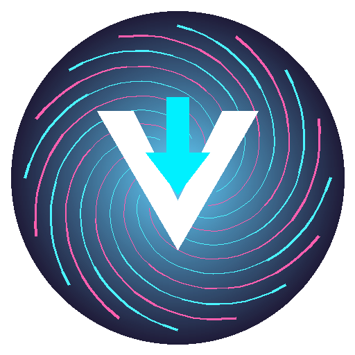

<div align="center">



# ⚡ VortexDL v3.0.0

**Next-Gen Premium Cross-Platform Video & Audio Downloader**

[](LICENSE)
[](https://www.python.org/downloads/)
[](https://github.com/bilaltuncil0/VideoDownloader)
[](https://aria2.github.io/)

</div>

---

## 🌟 What is VortexDL?

**VortexDL** (formerly VideoDownloader) is a market-leading, high-performance multimedia download suite powered by `yt-dlp`, `ffmpeg`, and `aria2c`. Engineered with a modern **CustomTkinter** UI, VortexDL provides seamless media extraction from YouTube, TikTok, Instagram, Twitter/X, and 1000+ supported sites.

---

## ✨ Features in v3.0.0

- 🎨 **Redesigned Luxury UI**: Neo-cyberpunk palette, rounded card frames, high-contrast typography, and smooth tab navigation.
- 🌍 **Global Localization (7 Languages)**:
  - 🇹🇷 Türkçe (`tr_TR`)
  - 🇺🇸 English (`en_US`)
  - 🇩🇪 Deutsch (`de_DE`)
  - 🇫🇷 Français (`fr_FR`)
  - 🇮🇹 Italiano (`it_IT`)
  - 🇸🇦 العربية (`ar_SA`)
  - 🇨🇳 简体中文 (`zh_CN`)
- 📜 **Download History (SQLite)**: Automatically tracks downloaded media with timestamps, file paths, file sizes, and quick actions (open folder, delete).
- ⚡ **Turbocharged Speed with `aria2c`**: Multi-connection parallel chunk downloading (up to 16 threads).
- 🚀 **Asynchronous Auto-Updater**: Instant GitHub Releases release check without UI blocking.
- 🛡️ **Privacy & Secure Cleanup**: Automatic zero-fill wipe for broken `.part` temporary files, and obfuscated settings storage.
- ☁️ **Configurable Cloud Integration**: Support for custom user-supplied Google Drive & OneDrive API keys.

---

## 🖥️ Cross-Platform Pre-built Binaries

Download ready-to-run packages from [GitHub Releases](https://github.com/bilaltuncil0/VideoDownloader/releases):
- 🐧 **Linux**: `VortexDL-Linux-x86_64`
- 🪟 **Windows**: `VortexDL-Windows-x64.exe`
- 🍏 **macOS**: `VortexDL-macOS-x64.dmg`

---

## 🚀 Running from Source

```bash
# 1. Clone repository
git clone https://github.com/bilaltuncil0/VideoDownloader.git
cd VideoDownloader

# 2. Setup virtual environment
python3 -m venv .venv
source .venv/bin/activate

# 3. Install dependencies
pip install -r requirements.txt

# 4. Launch VortexDL
python3 downloader.py
```

---

## ⚖️ License & Disclaimer

Distributed under the **GNU General Public License v3.0**. See `LICENSE` for details.
*Disclaimer: VortexDL is intended solely for personal, non-commercial use with public-domain or authorized multimedia content.*
